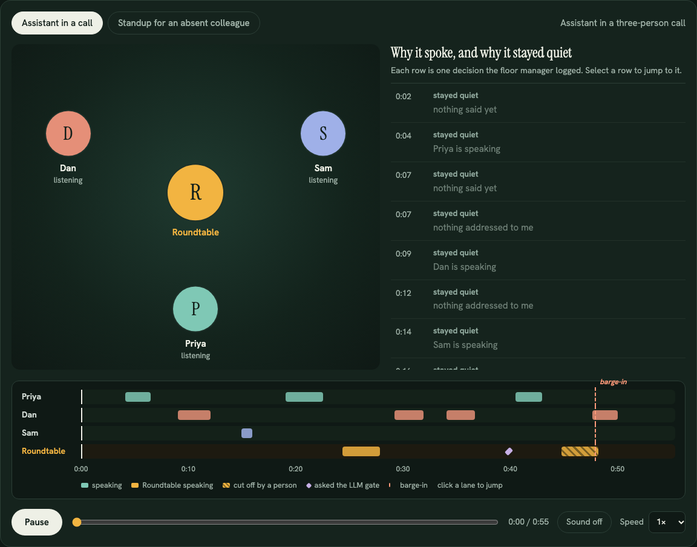
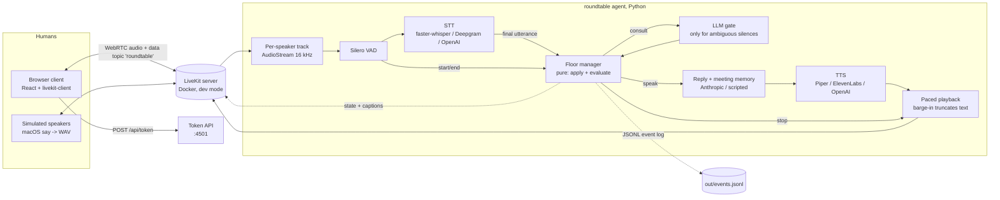

# Roundtable

[](https://github.com/codealisha99/roundtable/actions/workflows/ci.yml)

A voice agent that joins a multi-person group call as one participant and behaves like a good meeting attendee. Several humans talk, sometimes over each other. The agent tracks who said what, decides whether a turn is for it, waits for a real gap, speaks when it is asked or has something useful to add, and stops immediately when someone talks over it.

The hard part is multi-party turn-taking, not the 1:1 voice loop. Most voice agents assume one speaker. Here the floor manager is a pure, well-tested state machine over the transcript and per-speaker voice activity. It knows nothing about LiveKit, so every turn-taking rule is checked against scripted timelines.

**Landing page:** https://roundtable-site-pi.vercel.app/ (static, with the replay of the recorded run)

**Live demo:** none hosted. A hosted version needs a LiveKit server, a CPU-heavy speech-to-text and text-to-speech agent, and an LLM key, so none is deployed. Run it locally below. The recorded run is on the landing page above.



The landing page source is in [site/](site/). Its recording comes from `make demo` followed by `make replay`.

**Keyless demo:** `make install && make demo` runs LiveKit in Docker, runs two scenarios (an assistant in a three-person call, and a standup proxy for an absent colleague), and asserts the agent's behaviour from its own event logs.

## Architecture



Each human gets their own audio stream, their own VAD, and their own STT task. The agent sees speech *starts* immediately (for barge-in) and speech *finals* when STT finishes, so a slow transcription never delays interruption.

## What's hard, and how it is solved

1. **Floor manager as a pure module.** `src/roundtable/floor/` has no LiveKit imports. `apply(state, event)` is a reducer over immutable events (`Utterance`, `Activity`, `AgentStarted`, `AgentEnded`). `evaluate(state, now)` returns `wait | speak | stop | consult` with a human-readable reason. Those reasons are what the web panel and the event log show, so "why it stayed silent" is never a mystery.
2. **Addressing without a model in the loop.** Cheap text cues decide most turns: the agent's name or alias, a name at the start of a line (`Dan, can you...`), a question with silence after it, a follow-up in the 20 s after the agent spoke. A participant's name inside a sentence does not count ("I think Dan is right" is not addressed to Dan). The agent's name counts when used bare or as `@name`. After a determiner ("let's take it to the roundtable") it is a noun, unless the line opens with it and a comma follows ("The roundtable, what now?").
3. **Gaps are measured, not guessed.** The agent never starts while anyone has VAD open. It waits 700 ms after someone addressing it, 1.5 s after an unanswered group question, and 1.2 s of quiet after any overlap before starting anything.
4. **Two humans mid-exchange.** Three alternating human turns between two people inside 30 s is a back-and-forth. The agent backs off from unaddressed questions. Addressing it by name still works.
5. **Barge-in with honest truncation.** Human speech over the agent for 250 ms cancels playback. The agent counts only the audio that actually left the speaker (pushed minus still-queued) and truncates its own transcript line to that share of words. The meeting record shows what was heard, not what was planned.
6. **Heuristic first, LLM for ambiguity.** The LLM gate is consulted only for decision-relevant statements that nobody answered (at most once per 20 s). It returns JSON, and malformed output fails closed. Approval is re-checked against the floor before anything plays, so a turn never starts over someone who began talking during the model call.
7. **Standup proxy mode.** `roundtable agent --mode standup --absent Sam --update "..." --notes notes.md` answers to "Sam", delivers the prepared update once, answers follow-ups only from the notes, and says it will take anything else back to Sam. The keyless demo runs this as its second scenario.

## Quickstart

Prerequisites: macOS (uses `say` for the simulated speakers), Docker, uv (Python 3.12), pnpm.

```bash
make install          # uv sync + pnpm install
make test             # 59 unit tests: floor timelines, meeting memory, echo guard, prompts, token API
make demo             # keyless end-to-end run, two scenarios; prints transcript, decisions, checks
make replay           # after demo: publish the recorded run into site/replay (MP3 + timeline)
```

`make demo` writes, per scenario under `out/e2e/<assistant|standup>/`, the agent's event log (`events.jsonl`), the notes (`meeting.md`), the agent log, `recording.json` (timeline and checks) and `mixed.wav` (the room audio). It stops the LiveKit container when it finishes.

To use the web client with a live agent:

```bash
docker run -d --name roundtable-livekit -p 7880:7880 -p 7881:7881 -p 7882:7882/udp \
  livekit/livekit-server --dev --bind 0.0.0.0 --node-ip 127.0.0.1
make agent            # in one terminal: the agent joins room "roundtable"
make serve            # in another: token API on 4501
make web              # builds web/dist; then: cd web && pnpm preview  (http://127.0.0.1:4500)
```

Open the web app, enter a name, and take a seat. The agent is named "Roundtable" and responds to "Roundtable" or "round table". Meeting notes are written to `out/meeting.md` when the agent exits (Ctrl-C).

### Real providers

Set keys in `.env` (see `.env.example`). The provider is selected by env:

- LLM: `ANTHROPIC_API_KEY` selects Anthropic (`ROUNDTABLE_MODEL`, default `claude-sonnet-5-5`). `ROUNDTABLE_LLM=openai` uses any OpenAI-compatible URL (Ollama, OpenRouter, Groq).
- STT: `DEEPGRAM_API_KEY` selects Deepgram. `ROUNDTABLE_STT=openai` uses OpenAI transcription. Default is local faster-whisper.
- TTS: `ELEVENLABS_API_KEY` selects ElevenLabs. `ROUNDTABLE_TTS=openai` uses OpenAI speech. Default is local Piper.

The keyless demo pins `ROUNDTABLE_LLM=scripted`, `ROUNDTABLE_STT=local`, and `ROUNDTABLE_TTS=piper`, so it never reaches a cloud provider even when keys are exported.

## Design decisions and trade-offs

- **Pure floor, thin runtime.** The runtime (`agent.py`) only translates LiveKit events into floor events and floor verdicts into speech. That made the most important logic testable in milliseconds with scripted timelines.
- **Per-speaker pipelines, not a mixed stream.** Mixing would lose attribution and make barge-in detection depend on the mixture. Separate tracks cost a few more VAD instances, which Silero handles cheaply on CPU.
- **Deterministic memory extraction.** Decisions, action items and notes come from cue phrases plus addressing, so they work offline and are testable. A rolling LLM summary sits on top. Owners come from "I'll ..." (the speaker) or a name in the sentence.
- **Keyless first, cloud by env.** The keyless path is what the demo proves. Cloud adapters are small and selected by key presence, so the same code path runs in both modes.
- **Event log as the contract.** The end-to-end test asserts on the agent's own JSONL log rather than scraping console output. The same log drives the debugging workflow.
- **Dev keys.** `LIVEKIT_API_KEY=devkey` and `LIVEKIT_API_SECRET=secret` are the `livekit-server --dev` defaults. They are for local development only and must never be used in a deployed environment. Production needs real keys and a real secret, set through the environment.
- **Token API hardening.** `POST /api/token` caps request bodies at 2 KiB (413 above that) and validates name and room. It is not rate limited, so it should sit behind a gateway or be kept on localhost.

## Verification status

| What | Status |
| --- | --- |
| Floor manager, meeting memory, echo guard, prompt builders, token API (`make test`, 59 tests) | Passing |
| Keyless end-to-end demo (`make demo`): LiveKit in Docker, two scenarios, 3 and 2 simulated speakers, 27 checks | Passing (17 + 10) |
| Web client: loads, joins the LiveKit room with a fake microphone, shows the agent panel and the self tile (headless Chromium via Playwright) | Passing (`cd web && pnpm verify`, needs the live stack) |
| Local providers: faster-whisper, Piper, Silero VAD | Exercised by the demo |
| Anthropic and OpenAI-compatible LLM paths | **Not exercised**: no API keys on this machine. Code follows the SDK and REST shapes; verify before relying on it |
| Deepgram, ElevenLabs, OpenAI speech adapters | **Not exercised**: no keys. Plain REST, written against the documented endpoints |
| Standup proxy mode | Unit-tested and in the live demo: update on Sam's turn, once; a follow-up answered from the notes; an unknown question deferred. The notes brain in the demo is scripted |

## Limitations and next steps

- **Partial transcripts.** STT runs per utterance when VAD closes the segment. Captions appear after the speaker pauses, not word by word. Streaming STT (for example Deepgram live or a rolling whisper window) would tighten captions and let the floor react earlier.
- **Echo, handled: one sound on two tracks.** When a person's speakers leak into their microphone, the same words arrive on two tracks. The agent holds each finished segment for 0.8 s, then keeps one line: the copy that started first, or the louder copy when both start within 0.3 s. It drops a copy of at least three words from another speaker that overlaps in time and is at least 85% similar after speech-to-text. This costs about 0.8 s of latency on every line. Tests: `tests/test_echo.py`. Verified with a live echo of each sim speaker 150 ms late at 40% gain on Jo's track: before, every line appeared twice and the question was answered on both copies; after, one line each, attributed to the original speaker.
- **Echo, not handled.** (1) Pre-recorded or misaligned input: a copy that starts more than 0.3 s before the original is kept as the speaker, because the agent cannot tell which copy is the original. Live echo always trails its source, so this only happens with a fake or replayed microphone (as in a browser test fed with room audio). (2) Copies whose words differ a lot (noise, accents, another language) are not matched. (3) Two people who really say the same three or more words at the same moment are merged. (4) A copy that ends more than 0.8 s after the original can arrive after the original is released and be kept. (5) The agent's own voice leaking into a human's microphone: the transcript guard does not see it, and barge-in is driven by voice activity on the human's track, so the agent can still stop itself. Headphones or browser echo cancellation are the practical fix. Speaker-level echo suppression is not implemented.
- **Agent name as a common noun.** A name after a determiner ("the roundtable") no longer addresses the agent unless the line opens with it and a comma follows. A bare mid-sentence use ("I think roundtable is good") still does. Telling those apart needs a model, not a rule.
- **Speaker identity** is the display name from the token. Two people with the same name would collapse into one speaker.
- **Heuristics are tuned on one scripted meeting.** Thresholds (700 ms gap, 250 ms barge-in, 1.5 s group-question silence) are reasonable defaults, not measured against real meetings. A labelled meeting corpus would be the next step.
- **Gate cost bound.** The LLM gate runs at most once per 20 s, and only for decision-relevant statements. A smarter gate (embedding-based relevance) would need evaluation data.
- **Piper voices download on first run** from Hugging Face. Offline machines need the voice pre-fetched into `ROUNDTABLE_VOICE_DIR`.
- **Mac-only demo.** The simulated speakers use `say`. The agent itself is cross-platform; the demo could use Piper for speech synthesis elsewhere.
- **Keyless standup brain is lexical.** The demo's notes-grounded replies match question words against note lines, which is good enough to show grounding and deferral, not a semantic answer.

## Layout

```
src/roundtable/floor/     pure floor manager: events, addressing cues, reducer + gate
src/roundtable/meeting/   transcript retrieval and meeting memory
src/roundtable/speech/    per-speaker pipeline, paced playback, STT/TTS adapters
src/roundtable/agent.py   LiveKit runtime: wiring, turns, barge-in, state broadcast
src/roundtable/respond.py prompt builders, replies, rolling summary, LLM gate prompt
src/roundtable/e2e/       keyless end-to-end harness, recorder and assertions
scripts/                  publish_replay.py: recorded run to site/replay (MP3 + JSON)
site/                     static landing page and replay player
web/                      React client: the table, agent panel, captions
tests/                    pytest suites (floor timelines, meeting, units)
```
